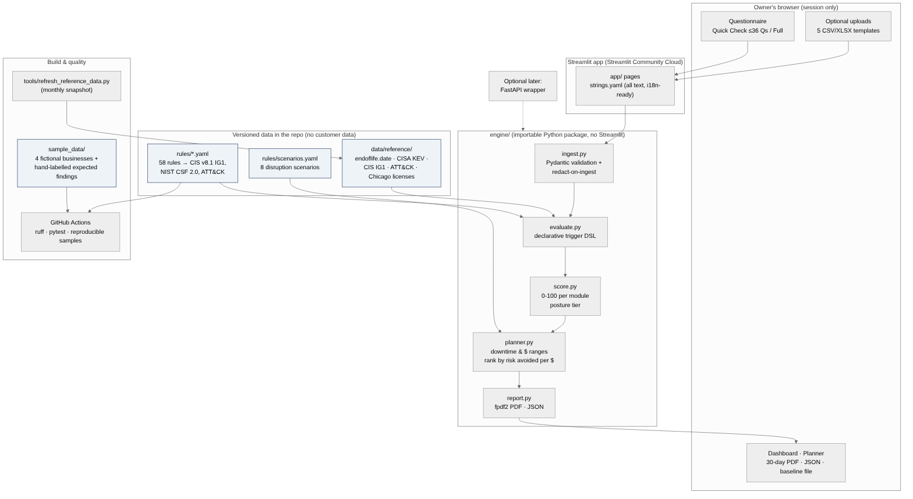

# NeighborhoodShield AI

**Affordable cybersecurity intelligence for community businesses.** A self-service assessment that tells a taqueria, a home daycare, or a barbershop which three security fixes matter most *for their business*, what ignoring them could cost in days closed and dollars, and how to fix them in 30 days.

A ChiEAC CommunityWealth AI project. Built by **Gyanendhar Reddy Reddymalla** (M.S. Cybersecurity, University of Houston; CompTIA Security+, CySA+; Associate of ISC2) for the [Chicago Education Advocacy Cooperative](https://chieac.org). Revenue from the product funds STEM-OPT opportunities for international graduates.

> **Status: Week 1 of 7 — design and foundations (Gate 1, Fri Nov 6, 2026).** The rule catalog, questionnaire, upload templates, reference data, and sample businesses are complete and tested. The rules engine runs from Week 2.



---

## What it does

1. **Intake.** A plain-language questionnaire: the *Quick Check* (32 to 36 questions, about 10 minutes, follow-ups only when relevant) or the *Full Assessment* (52 questions plus optional CSV/XLSX uploads).
2. **Ingest and redact.** Uploads are validated against typed templates and redacted the moment they are read. Nothing is written to server storage.
3. **Rules engine.** 62 explainable rules, each traceable to a CIS Controls v8.1 IG1 safeguard, a NIST CSF 2.0 subcategory, and a MITRE ATT&CK technique.
4. **Scoring.** 0 to 100 per module and a posture tier: Exposed, Fragile, Developing, Resilient.
5. **Business Survival Security Planner.** Turns each finding into estimated downtime and sales exposure *ranges* with editable assumptions, and ranks fixes by disruption avoided per dollar.
6. **Outputs.** Dashboard, 30-day improvement plan PDF with a contractor appendix, JSON export, and a baseline file for re-checks.

It is a **self-assessment, not an audit, penetration test, or certification**, and says so on every page.

## Week 1 deliverables

| Deliverable (brief §7) | Where | Beyond the brief |
|---|---|---|
| Repository, folder structure, README | this repo | `engine/` is an importable package from day 1 (FastAPI-ready) |
| Architecture diagram | [`docs/architecture/`](docs/architecture/) (`.drawio` editable in diagrams.net, `.mmd`, `.svg`, `.png`) | |
| CIS IG1 mapping sheet (XLSX), 40 to 60 rules | [`docs/mapping/CIS_IG1_mapping.xlsx`](docs/mapping/CIS_IG1_mapping.xlsx) | **Generated** from `rules/*.yaml` so spec and code cannot drift; live IG1 coverage (42 of 56), NIST CSF 2.0 and ATT&CK columns, gap rationale for every uncovered safeguard |
| Rule catalog | [`rules/`](rules/) — 62 rules (9 critical, 26 high, 19 medium, 8 low) | Machine-validated YAML with a declarative trigger DSL, not a spreadsheet only |
| Questionnaire v1, all strings in one YAML | [`content/strings.yaml`](content/strings.yaml) | Quick Check vs Full tiers, conditional follow-ups, reading-level test, YAML boolean-trap test |
| Five upload templates | [`templates/`](templates/) | Export guides for M365/Entra, Google Workspace, AD, Defender, pfSense; **read-only PowerShell exporters** that write the template format directly with labels instead of names |
| Synthetic data for 3 businesses | [`sample_data/`](sample_data/) | 3 businesses **plus a well-run control case**; real, dated software (endoflife.date, CISA KEV); **hand-labelled expected findings** that become the engine's test oracle; together they exercise all 62 rules |
| — | [`data/reference/`](data/reference/) | **Real-world data snapshots** with source and date on every row: endoflife.date (971 releases), CISA KEV (908 SMB-relevant of 1,767), CIS v8.1 IG1 (56), ATT&CK techniques, Chicago active business licenses |
| — | [`tests/`](tests/), [`.github/workflows/ci.yml`](.github/workflows/ci.yml) | 536 automated tests and CI from Week 1 (lint, catalog integrity, templates, samples, reference data, app smoke test, reproducible sample generation) |
| — | [`app/streamlit_app.py`](app/streamlit_app.py) | A running design preview for the Gate 1 demo, including a "Real-world data" page |
| — | [`docs/extensions.md`](docs/extensions.md) | **Ten extensions beyond the brief**: email domain check (SPF/DMARC), Illinois legal flags (BIPA, PIPA, PCI DSS), cyber-insurance readiness, calendar reminders, "bad day" card with verified Chicago/Illinois contacts, workshop mode with 55 Chicago Special Service Areas, monthly data refresh, free tool per fix, safe leaked-password check, published-survey benchmarks |

## Quick start (Windows, from `D:\NeighborhoodShield`)

```powershell
cd D:\NeighborhoodShield
py -3.12 -m venv .venv
.\.venv\Scripts\Activate.ps1
pip install -r requirements-dev.txt
pytest                                   # all tests should pass
streamlit run app\streamlit_app.py       # opens http://localhost:8501
```

macOS/Linux: `python3.12 -m venv .venv && source .venv/bin/activate`, then the same commands.

Useful commands:

```powershell
python tools\build_mapping_sheet.py             # rebuild the XLSX after editing rules/*.yaml
python tools\refresh_reference_data.py all      # refresh endoflife.date, CISA KEV, Chicago snapshots
python sample_data\generate.py                  # regenerate sample businesses (deterministic)
```

## Repository layout

```
app/                 Streamlit pages (UI only)
engine/              Importable package: schemas, loader (Weeks 2-6: ingest, evaluate, score, planner, report)
rules/               identity / network / patching / endpoint / recovery .yaml, scenarios.yaml, sources.yaml
content/             strings.yaml: every owner-facing sentence (Spanish-ready)
templates/           5 CSV templates, guides/, examples/, export_scripts/ (PowerShell)
sample_data/         generate.py and businesses/<name>/{profile,answers,expected_findings}.yaml + uploads/
data/reference/      dated snapshots of public data (no customer data, ever)
tools/               reference-data refresh, mapping-sheet builder
docs/                architecture, mapping XLSX, design, ADRs, data sources, gate reviews, LinkedIn drafts
tests/               pytest suite (runs in CI on every push)
```

## Frameworks and data

| Source | Used for |
|---|---|
| [CIS Controls v8.1, Implementation Group 1](https://www.cisecurity.org/controls/implementation-groups/ig1) | Anchor framework: every rule cites an IG1 safeguard |
| [NIST CSF 2.0](https://doi.org/10.6028/NIST.CSWP.29) and [SP 1300 Small Business Quick-Start](https://doi.org/10.6028/NIST.SP.1300) | Owner-facing structure; CSF subcategory per rule |
| [CISA Cyber Essentials](https://www.cisa.gov/resources-tools/resources/cyber-essentials), [Secure Our World](https://www.cisa.gov/secure-our-world), [KEV catalog](https://www.cisa.gov/known-exploited-vulnerabilities-catalog) | Plain-language fixes; actively exploited software |
| [endoflife.date](https://endoflife.date) | End-of-life lookup (snapshot, never called live) |
| [MITRE ATT&CK](https://attack.mitre.org) | Technique tags per rule and scenario (IDs verified against the official STIX bundle) |
| [FTC Cybersecurity for Small Business](https://www.ftc.gov/business-guidance/small-businesses/cybersecurity), [FBI BEC guidance](https://www.fbi.gov/how-we-can-help-you/scams-and-safety/common-frauds-and-scams/business-email-compromise) | Second citations and fraud controls |
| [City of Chicago Business Licenses](https://data.cityofchicago.org/) | Market sizing: 11,253 active Retail Food Establishment and 854 Children's Services Facility licenses (snapshot 2026-11-04) |
| [Chicago Special Service Areas](https://www.chicago.gov/city/en/depts/dcd/supp_info/special_service_areasandproviderlist.html) | 55 active SSAs and their service providers: workshop partner prospects |
| Illinois statutes ([BIPA 740 ILCS 14](https://www.ilga.gov/legislation/ilcs/ilcs3.asp?ActID=3004&ChapterID=57), [PIPA 815 ILCS 530/10](https://ilga.gov/legislation/ilcs/documents/081505300K10.htm)) | Text-only legal flags |
| Published small-business surveys (Cyber Readiness Institute, Nationwide, Guardz, EasyDMARC, Verizon DBIR) | "How you compare" benchmarks and Planner calibration |

See [`docs/data_sources.md`](docs/data_sources.md) for provenance and refresh policy.

## Privacy and acceptable use

* No server-side storage of answers or uploads; the browser session is the only state.
* Redact on ingest: user IDs hashed, IP addresses truncated to network, device names turned into role labels.
* The repository contains only public reference data and fictional sample businesses.
* Assess only systems you own or are authorized to assess.

## Roadmap

| Week | Dates (2026) | Gate |
|---|---|---|
| 1 | Nov 2 – 6 | **Gate 1: design review** ← you are here |
| 2 | Nov 9 – 13 | Intake, parsers with redaction, rules engine core, Module 1 |
| 3 | Nov 16 – 20 | Modules 2 and 3 — Gate 2 |
| 4 | Nov 23 – 27 | Modules 4 and 5, scoring, dashboard |
| 5 | Nov 30 – Dec 4 | Business Survival Security Planner — Gate 3 |
| 6 | Dec 7 – 11 | PDF, JSON, baseline comparison, deployment |
| 7 | Dec 14 – 18 | Pilots, guides, demo video — Gate 4 |

## Ownership

ChiEAC owns the NeighborhoodShield AI product, name, and repository. Builder credit: Gyanendhar Reddy Reddymalla.

## License

Released under the [MIT License](LICENSE).
